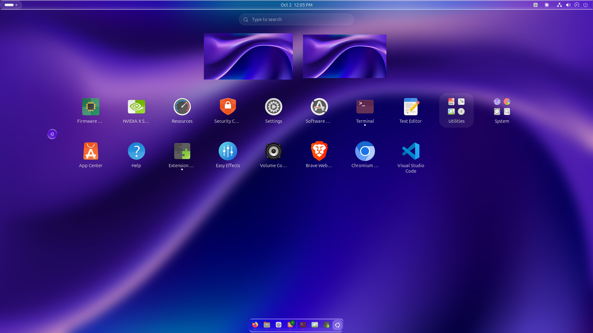
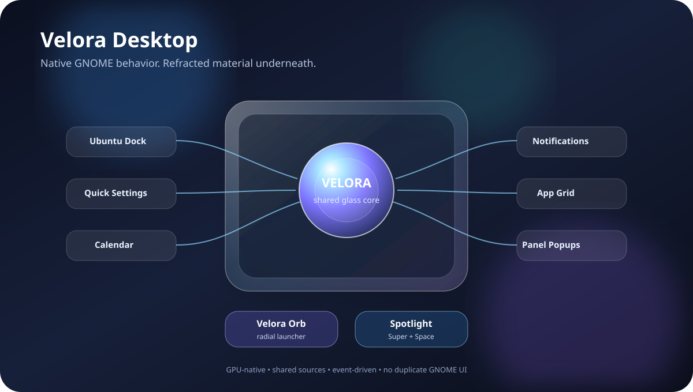
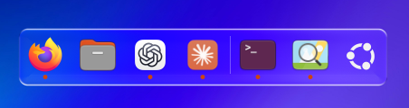
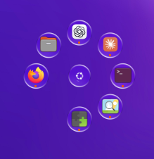
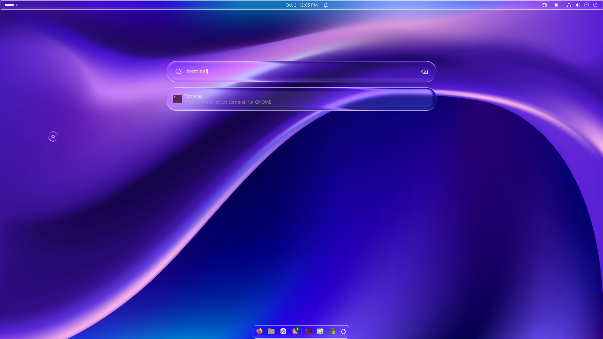
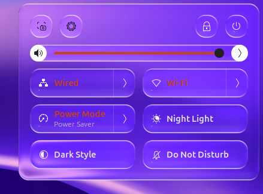
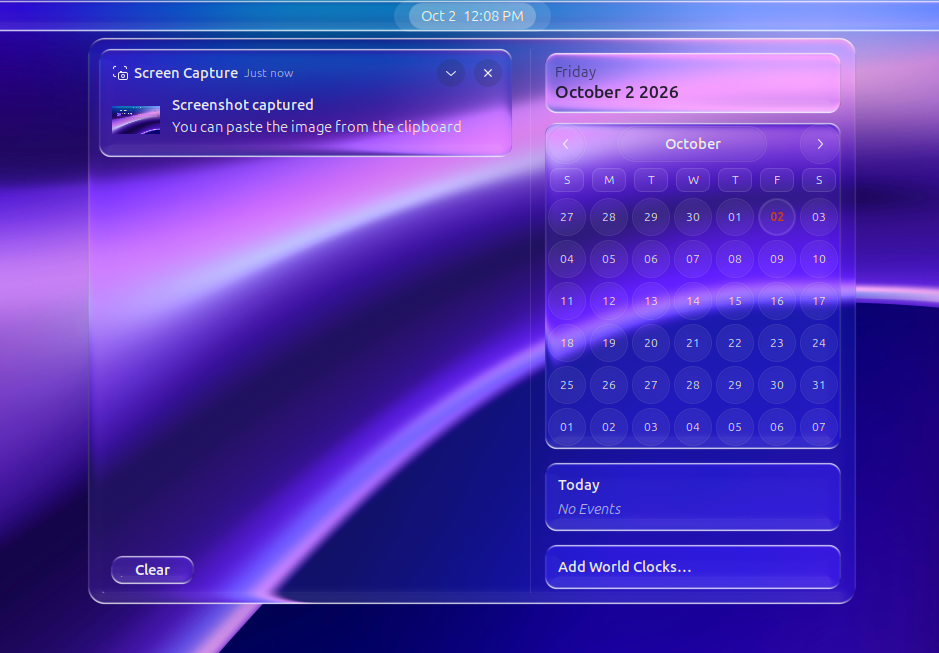
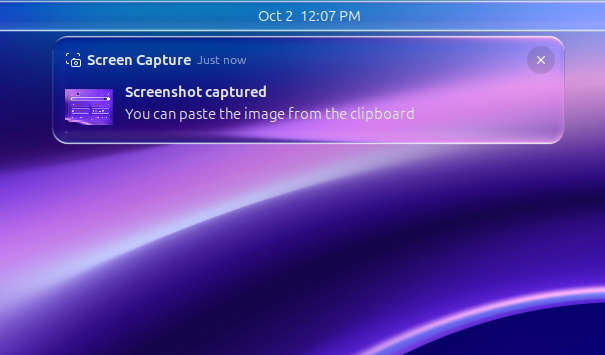
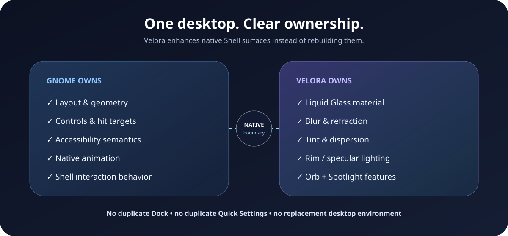
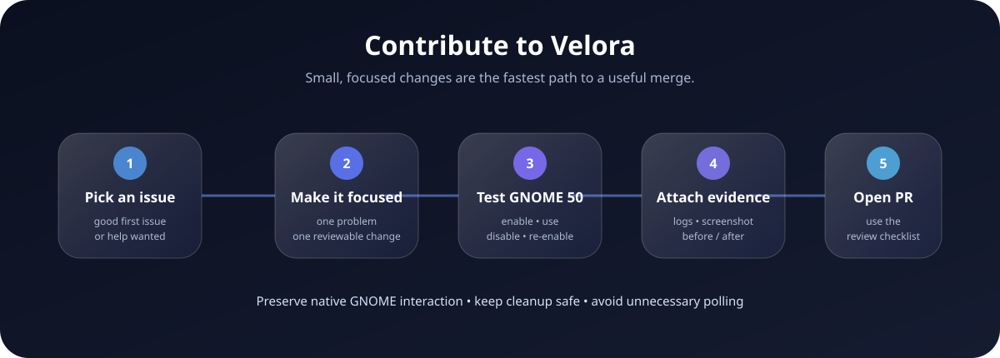

# Velora Desktop

<p align="center">
  <strong>Liquid Glass + Frosted Crystal for GNOME Shell 50 — without replacing GNOME.</strong>
</p>

<p align="center">
  Velora gives supported GNOME Shell surfaces two switchable materials—refractive Liquid Glass and matte Frosted Crystal—alongside a radial launcher and Spotlight-style app search, while preserving native layout, controls, accessibility and interaction.
</p>

<p align="center">
  <a href="LICENSE"></a>
  
  <a href="https://github.com/Anuppaul/velora-desktop/actions/workflows/repository-checks.yml"></a>
  <a href="https://github.com/Anuppaul/velora-desktop/actions/workflows/codeql.yml"></a>
  <a href="https://github.com/Anuppaul/velora-desktop/issues?q=is%3Aissue%20is%3Aopen%20label%3A%22good%20first%20issue%22"></a>
</p>

<p align="center">
  
</p>

<p align="center">
  <a href="#features"><b>Features</b></a>
  ·
  <a href="#gallery"><b>Gallery</b></a>
  ·
  <a href="#install"><b>Install</b></a>
  ·
  <a href="#architecture"><b>Architecture</b></a>
  ·
  <a href="#contributing"><b>Contribute</b></a>
  ·
  <a href="#project-resources"><b>Project Docs</b></a>
</p>

> [!NOTE]
> **Project status:** active development · GNOME Shell 50 · source installation/update supported. Velora is not claiming official GNOME Extensions publication yet.

## Why Velora

Velora follows one rule:

> **Native GNOME behavior first. Change the material, not the desktop interaction model.**

It does not place a second Dock over Ubuntu Dock, recreate Quick Settings, duplicate the calendar, or replace GNOME's controls. GNOME still owns geometry, hit targets, accessibility, input and animation. Velora works beneath supported Shell surfaces and changes the material they are painted with.

<p align="center">
  
</p>

## Features

| | |
| --- | --- |
| **Two live-switchable materials** | Liquid Glass v10 preserves glossy refraction and highlights. Frosted Crystal adds stronger native backdrop diffusion, matte color, fine static grain and a softer illuminated crystal rim. Both now have a subtle adaptive icy-blue edge, readable over dark and light wallpaper. |
| **Velora Orb** | Draggable, multi-monitor radial launcher with Dock Apps, Custom Apps and All Apps sources, paging, previews, tooltips and running indicators. |
| **Velora Spotlight** | Centered `Super+Space` application search with adaptive glass and native-style result presentation. |
| **Ubuntu Dock integration & settings** | Restyles the existing Ubuntu Dock and lets you manage its native autohide, intellihide, pressure, delays, position, panel mode, icons, application list and click actions inside Velora Preferences. |
| **Native Shell surfaces** | Shared glass treatment for Quick Settings, Date/Calendar, notifications, panel/status popups and supported Shell-owned cards. |
| **Monitor-safe launcher geometry** | Orbit, Star, Molecule, Spiral and Petal layouts with fit-first placement and paging near monitor edges/corners. |
| **Adaptive text** | Light/dark foreground treatment where Velora owns the visual layer, without replacing semantic GNOME states. |
| **Low-overhead design** | Shared sources, compositor-native actors/effects, cached/downscaled blur and event-driven updates instead of permanent JS polling. |

## Choose a Glass Material

Open **GNOME Extensions → Velora Desktop → Preferences → Appearance → Glass Material** and select **Liquid Glass** or **Frosted Crystal**. The mode switches live; it stays selected after logout or restart.

| Material | Appearance | Adjustable controls |
| --- | --- | --- |
| **Liquid Glass** (default) | Original v10 refractive lens, chromatic highlights and glossy edge lighting, now with **strong Frosted-like backdrop blur** | Existing Blur slider still controls the stored base radius; tint and Advanced optics remain untouched. |
| **Frosted Crystal** | Dense pearl-white satin diffusion, strongly softened backdrop, subtle 4px micro-etched crystal texture, near-zero rainbow fringe and broad ice-blue edge glow | Frost Density, Micro-grain and Crystal Edge Glow |

At the default Frost Density, the frosted material now masks most fine wallpaper detail instead of resembling a lightly tinted Liquid surface. Its diffuse crystal texture is spatially stable rather than animated. Selecting Liquid restores the original sharp refractive lens and chromatic optics without resetting any Advanced settings. Increasing Frost Density increases matte coverage; lowering it lets more wallpaper detail through.

Switching back to Liquid Glass restores the saved v10 lens, tint and Advanced optics, together with the **new stronger Liquid backdrop blur**. At the default Frost Density (88%), the two modes have comparable background diffusion; Liquid still bends the image at the edges, while Frosted stays matte and nearly achromatic. The original blur slider value is never rewritten. Setting Blur to **0** disables blur in both modes; other slider values are applied through the shared existing blur pipeline with a material-specific boost. Frosted controls are saved separately; neither mode introduces a second overlay or noise texture. Stronger blur can cost more GPU work in **either** mode, so no performance claim is made without a compositor trace.

The material picker applies across supported Velora-owned and vendor-native shell surfaces, including the Orb, Spotlight, Dock and top panel glass surfaces, window previews, calendar, Quick Settings and supported popups. Individual native surfaces that intentionally remain non-glass in certain modes (such as Ubuntu Dock's plain panel fallback) keep their established behavior.

### Adaptive icy-blue edges

Velora's glass cards use a thin, rounded, icy-blue optical contour rather than a CSS border. The color adapts to the *actual backdrop* (and to the matte body in Frosted Crystal): **soft pale-blue on dark backgrounds** and **very light, low-saturation blue-gray on bright/white backgrounds**. The bright-side color coverage is also reduced, so it reads as a thin premium contour rather than a blue outline. The effect is contained entirely within the existing glass shader's 1–3px rim, with no second layer, no halo outside the card, and no new GPU texture or capture pass.

The original Liquid Glass refraction and Frosted Crystal matte finish still differ; the contour only improves the legibility of both surfaces against contrasting wallpapers. Preview cards retain their compact 480×270 fixed 16:9 layout, and native controls and input remain unchanged.

## Gallery

### Native Dock + Velora Orb

<table>
  <tr>
    <td width="62%" align="center">
      
    </td>
    <td width="38%" align="center">
      
    </td>
  </tr>
  <tr>
    <td align="center"><sub>Native Ubuntu Dock with Velora material.</sub></td>
    <td align="center"><sub>Velora Orb radial launcher.</sub></td>
  </tr>
</table>

### Spotlight

<p align="center">
  
</p>

<p align="center"><sub><code>Super+Space</code> opens Velora Spotlight without replacing GNOME Overview.</sub></p>

### System surfaces

<table>
  <tr>
    <td width="34%" align="center">
      
    </td>
    <td width="36%" align="center">
      
    </td>
    <td width="30%" align="center">
      
    </td>
  </tr>
  <tr>
    <td align="center"><sub>Quick Settings</sub></td>
    <td align="center"><sub>Date / Calendar</sub></td>
    <td align="center"><sub>Notification card</sub></td>
  </tr>
</table>

## Native-first design

<p align="center">
  
</p>

| Surface | GNOME keeps | Velora changes |
| --- | --- | --- |
| Ubuntu Dock / Dash-to-Dock | icons, hit targets, autohide/intellihide, app behavior | supported background/material |
| App Grid / Overview | application view, interaction, layout | supported backdrop/material |
| Quick Settings | controls, geometry, interaction | supported Shell material |
| Date / Calendar | calendar, controls, animation | glass material underneath |
| Notifications | content, actions, animation | supported card material |
| Panel / status popups | `PopupMenu` / `BoxPointer` ownership | shared glass material |

Velora deliberately leaves GTK/libadwaita application interiors, GNOME accessibility ownership, native hit targets and native animation semantics alone.

## Manage Ubuntu Dock from Velora

Open **GNOME Extensions → Velora Desktop → Preferences → Dock**. Velora
detects the installed Ubuntu Dock settings schema and provides its native
controls directly, without copying or replacing the dock.

The Dock page includes:

- **Visibility:** Always visible, Intelligent hide (window overlap), Auto-hide
  (pointer at the screen edge), pressure-to-reveal, pressure threshold,
  show/hide delays, native slide animation, fullscreen reveal and manual hide.
- **Layout:** native position (top/right/bottom/left), Panel mode, icon size,
  fixed icon size, dock length, center icons, multi-monitor and compact spacing.
- **Content and interactions:** favorites, running apps, Trash/drives, Show
  Applications, native window previews, workspace/monitor filtering,
  click action, wheel action, running indicator style and keyboard shortcuts.
- **Restore Intelligent Auto-hide:** an explicit action to unpin Ubuntu Dock,
  re-enable overlap avoidance and pointer-edge reveal, disable manual hide and
  disable the pressure barrier. It never changes settings just from opening
  the Dock page. Your original custom values remain until you edit them.

**Native ownership:** the controls write to the existing
`org.gnome.shell.extensions.dash-to-dock` GSettings schema, so Ubuntu Dock's
own settings and Velora stay in sync. On unsupported installations the page
shows an unavailable message instead of inventing a separate dock. Velora
does not call Ubuntu Dock's hide/show animations itself.

**Auto-hide repair:** the GNOME 50 bridge now reads the actual native slider
when no slide override is supplied (the earlier JS `Number(null) === 0`
coercion incorrectly treated the dock as hidden). Intelligent-hide overlap
checks anchor to Ubuntu Dock's stable fully-visible `_staticBox`, instead of
the moving hidden allocation. Velora-only vertical offsets adjust that box
consistently. Native preference changes cause one coalesced hover/overlap
reconciliation, not a new polling or hide/show loop.

The existing Velora-specific **vertical dock offset** remains at the bottom
of this page and is ignored in Panel mode. Ubuntu Dock and GNOME still own
icons, native edge detection, pressure barriers, window-overlap decisions and
accessibility.

## Velora Orb

The Orb can be used as a focused launcher or as a compact full app launcher.

| Source | Contents |
| --- | --- |
| **Dock Apps** | Ubuntu favorites + currently running apps |
| **Custom Apps** | only applications selected in Velora Preferences |
| **All Apps** | visible installed applications, alphabetically |

Scroll over the Orb to change pages when the selected source contains more apps than the current layout can display.

Available geometries:

`Orbit` · `Star` · `Molecule` · `Spiral` · `Petal`

<details>
<summary><b>Monitor-safe layout behavior</b></summary>

Velora generates the requested geometry, measures the active monitor, translates the layout inward and scales it when necessary. If the complete shape still cannot fit cleanly, Velora removes a complete outer level and moves overflow applications to the next page instead of silently dropping individual slots.

This is especially important with **All Apps** near monitor edges and corners.

</details>

## Install

### Requirements

- **GNOME Shell 50**
- Ubuntu / GNOME environment running GNOME Shell 50
- extension UUID: `velora@wonderer.tech`

### 1. Clone

```bash
git clone https://github.com/Anuppaul/velora-desktop.git
cd velora-desktop
```

### 2. Install

```bash
bash gnome-shell/install.sh
```

> [!IMPORTANT]
> A clean first install normally requires **one Log Out → Log In** so the running GNOME Shell session can discover the new local extension. If the installer reports that Velora is already active, you can skip the logout.

### 3. Verify

```bash
gnome-extensions list --active | grep velora@wonderer.tech
```

Expected:

```text
velora@wonderer.tech
```

### 4. Open Preferences

```bash
gnome-extensions prefs velora@wonderer.tech
```

## Update

```bash
cd velora-desktop
git pull --ff-only origin main
bash gnome-shell/install.sh
```

Normal runtime-only revisions use Velora's hot-swap path and normally do **not** require another logout. A session refresh is expected only when GNOME must discover changed bootstrap/schema state.

## Architecture

Velora is a **Shell material extension**, not a replacement desktop environment.

The integration model is intentionally small:

```text
runtime.js
├── orbThemeRuntime.js
├── spotlightSearch.js
├── popupGlass.js
├── notificationGlass.js
├── shellCards.js
├── appGridBackdrop.js
└── liquidGlassDock.js
    └── vendor/liquid-glass/
```

### Popup integration

GNOME Shell 50 owns popup geometry through `BoxPointer`. Velora inserts its material inside the native popup hierarchy below the original menu content, so GNOME continues to own position, scale, opacity, accessibility and open/close animation.

### Renderer

Velora does not use CPU screenshots to fake transparency. The material pipeline uses compositor-native GPU actors/effects with shared wallpaper sources and live compositor clones only where required.

The renderer supports:

- Gaussian and Dual-Kawase blur
- downscaled blur and cache/reuse
- edge displacement / refraction
- chromatic dispersion
- tint, brightness, contrast and saturation
- rim/specular lighting
- optical sampling beyond native card bounds

For the full implementation model, see [docs/ARCHITECTURE.md](docs/ARCHITECTURE.md).

## Performance principles

Velora's runtime is designed around a few constraints:

- no permanent JavaScript polling loop for PopupMenu surfaces
- no CPU framebuffer screenshot loop
- shared wallpaper/background sources
- compositor-native Clutter/Mutter rendering paths
- Orb Liquid Glass allocates extra 16-region shader batches only when large app pages need them; hidden batches avoid redundant uniform updates
- cached/downscaled blur where appropriate
- property writes avoided when values have not changed
- hot-path Orb geometry comparison avoids per-frame JSON serialization for static app pages; native Shell-card glass avoids repeated capture-clip and geometry-uniform writes while stationary
- Orb paging reuses the current open-menu app selection, fitted radial layout and repeated page-size slot plans; normal close and explicit changes rebuild them
- up to two inactive Orb pages retain detached button/icon actors only while the menu is open, avoiding re-creating the same icon textures on scroll; cache is released on close, refresh or disable
- unchanged adaptive-text inline styles and stationary Orb capture bounds are not re-applied each refresh
- expensive material created only where required
- unchanged Overview blur settings and search-card capture bounds are not re-applied every refresh
- Overview window captions reuse sampled geometry and skip unchanged color writes; empty close-button glass regions clear just once
- native Overview actor add/remove events invalidate the window-chrome registry; quiet frames skip full-tree scans with a conservative fallback reconciliation
- Ubuntu Dock Panel Mode uses its own strictly **panel-sized LiquidEffect** (Velora refraction, micro-grain and 15% milky-white body shade) behind native DockDash icons; 0px square corners and a native fallback remain, without DashManager's full-screen FBO.
- native GNOME animation remains responsible for transforms

Performance-sensitive changes should include reproducible before/after evidence where practical.

Velora's shared Liquid Glass shader uses a subtle **static micro-grain** and a **15% milky-white body shade** in both flat and refractive paths. The shade is applied before the configurable user tint, without changing glass alpha; no extra overlay actors, GPU textures, or render passes are required. Panel-mode Dock, transparent margins and shadow-only pixels stay unchanged. See the [optional performance capture guide](docs/PERFORMANCE.md) for GNOME Shell CPU/RAM and NVIDIA GPU baseline comparisons.

## Development

Useful GNOME Shell logs:

```bash
journalctl -f -o cat /usr/bin/gnome-shell | grep -i -E 'velora|liquid glass|liquidglass'
```

Contributor setup, smoke testing and component ownership are documented in:

- [Development Guide](docs/DEVELOPMENT.md)
- [Contributor Map](docs/CONTRIBUTOR_MAP.md)
- [Architecture](docs/ARCHITECTURE.md)

## Contributing

<p align="center">
  
</p>

Contributions are welcome across code, testing, accessibility, compatibility, documentation and performance work.

**Start here:**

- [Community Hub](COMMUNITY.md)
- [Contributor Guide](CONTRIBUTING.md)
- [Good First Issues](https://github.com/Anuppaul/velora-desktop/issues?q=is%3Aissue%20is%3Aopen%20label%3A%22good%20first%20issue%22)
- [Help Wanted](https://github.com/Anuppaul/velora-desktop/issues?q=is%3Aissue%20is%3Aopen%20label%3A%22help%20wanted%22)
- [Discussions](https://github.com/Anuppaul/velora-desktop/discussions)

If you are changing Shell integration behavior, preserve the core contract:

- keep native GNOME/Ubuntu interaction and layout
- avoid duplicate native controls when material-only integration is possible
- keep enable/disable cleanup safe
- avoid unnecessary polling or CPU capture paths
- document architecture changes
- preserve third-party licensing and provenance

## Project resources

| Area | Resources |
| --- | --- |
| **Community** | [Community Hub](COMMUNITY.md) · [Contributing](CONTRIBUTING.md) · [Contributors](CONTRIBUTORS.md) |
| **Development** | [Docs Index](docs/README.md) · [Development Guide](docs/DEVELOPMENT.md) · [Contributor Map](docs/CONTRIBUTOR_MAP.md) |
| **Direction** | [Roadmap](ROADMAP.md) · [Changelog](CHANGELOG.md) |
| **Maintenance** | [Governance](GOVERNANCE.md) · [Support](SUPPORT.md) · [Release Process](docs/RELEASE_PROCESS.md) · [Triage](docs/TRIAGE.md) |
| **Policies** | [Security](SECURITY.md) · [Code of Conduct](CODE_OF_CONDUCT.md) · [Third-Party Notices](THIRD_PARTY_NOTICES.md) |

## Security

Please do **not** publish exploit details for an unpatched vulnerability in a public issue.

See [SECURITY.md](SECURITY.md) for the responsible-disclosure process.

## License

Velora Desktop is released under the **MIT License**. See [LICENSE](LICENSE).

Velora also vendors/adapts third-party material whose copyright, license and provenance remain preserved. See [THIRD_PARTY_NOTICES.md](THIRD_PARTY_NOTICES.md).

---

<p align="center">
  <strong>Velora Desktop</strong><br>
  <sub>Native GNOME behavior, refracted.</sub>
</p>
